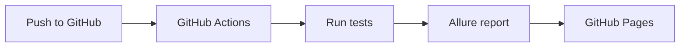

<h1 align="center">Hi, I'm Akhilesh 👋</h1>

  <b>QA Engineer moving into SDET roles</b> 
  I build test automation frameworks, run them in CI, and publish the reports.

  

## Featured projects

| Project | What it shows | Report |
|---|---|---|
| [Selenium + TestNG UI framework](https://github.com/akhileshntech/selenium-testng-ui-framework) | Page Object Model, parallel execution, data-driven tests, failure screenshots, CI | [Live Allure report](https://akhileshntech.github.io/selenium-testng-ui-framework/) |
| [REST Assured API framework](https://github.com/akhileshntech/restassured-api-framework) | Client layer, JSON schema validation, generated test data, 12 passing tests | [Live Allure report](https://akhileshntech.github.io/restassured-api-framework/) |
| [k6 performance tests](https://github.com/akhileshntech/k6-performance-testing) | Smoke, load, stress and spike tests with thresholds, up to 60 virtual users | Results in the README |

## How my projects run

## Tech I use

## Next on my list

- Playwright with TypeScript
- Cross-browser runs in CI
- BDD with Cucumber

## Connect

[LinkedIn](https://www.linkedin.com/in/akhilesh-n-7775a021b)
